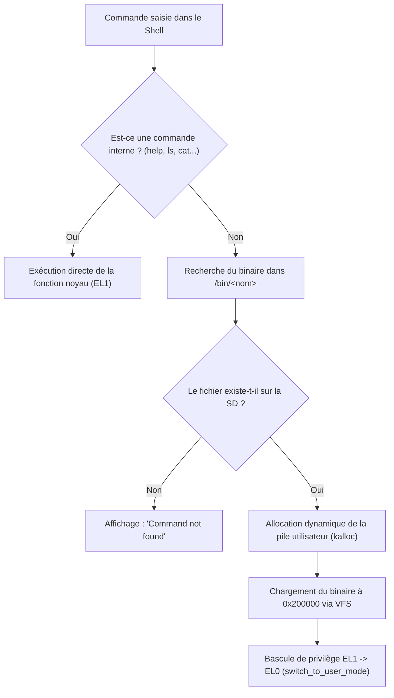

# Journal de bord - Perrytel OS

## 26. Chargement et Exécution de Binaires Autonomes en Espace Utilisateur (EL0)

**Date :** 29 Octobre 2026  
**Sujet :** Pipeline de compilation des applications utilisateur (`bin/`), injection sur partition FAT32, allocation dynamique de pile EL0, saut de privilège EL1 vers EL0 (`switch_to_user_mode`), cycle de vie du processus et terminaison par Syscall `exit` (93).

---

### 1. Introduction

Cette étape concrétise l'un des piliers fondamentaux de PerryTel OS : **la transition d'un système à commandes monolithiques intégrées vers un véritable système d'exploitation capable de charger et d'exécuter des programmes indépendants depuis le système de fichiers**.

Auparavant, toute nouvelle fonctionnalité devait être compilée en dur dans l'image du noyau et appelée directement sous forme de fonction noyau avec les privilèges maximaux (EL1). Désormais, des programmes autonomes compilés séparément sont stockés sur la carte SD dans le répertoire `/bin/`, chargés dynamiquement en mémoire vive et exécutés en mode non privilégié **EL0 (User Mode)** avec une pile isolée.

---

### 2. Pipeline de Compilation des Applications Utilisateur

Pour permettre l'exécution sans dépendance envers le code du noyau, une chaîne de production logicielle dédiée a été intégrée dans `build.sh` :

#### A. Spécifications de liaison (*Linker Flags*)
Les applications utilisateur situées dans le dossier `bin/` (tel que `bin/hello.c`) sont compilées selon les règles suivantes :
- **Adresse de chargement fixe (`-Wl,-Ttext,0x200000`)** : L'exécutable est lié pour s'exécuter à l'adresse virtuelle/physique `0x200000` (2 Mo), en dehors de l'espace réservé au code noyau (`0x80000`).
- **Autonomie complète (`-nostdlib -ffreestanding -static -no-pie`)** : Aucun runtime C standard n'est lié. Le point d'entrée officiel est défini directement sur la fonction `main` (`-Wl,-e,main`).
- **Liaison avec la bibliothèque utilisateur (`perrylib`)** : Les binaires sont liés avec `perrylib.o` (qui encapsule les appels système `svc #0`) et `string.o`.

#### B. Génération du binaire brut et injection sur la carte SD
1. Le fichier ELF est d'abord produit : `build/bin/<nom>.elf`.
2. L'utilitaire `aarch64-linux-gnu-objcopy -O binary` extrait la mémoire brute pour créer un binaire plat exécutable (`build/bin/<nom>`).
3. Pour l'environnement d'émulation QEMU, les utilitaires mtools (`mmd` et `mcopy`) injectent automatiquement le binaire sur la carte SD virtuelle (`sd.img@@1M`) dans le sous-dossier `::bin/<nom>`.

---

### 3. Architecture du Chargeur dans le Shell (`kernel/shell.c`)

Lorsque l'utilisateur saisit une commande dans l'invite interactive du shell, la fonction `exec()` applique une stratégie de résolution en deux temps :



#### A. Allocation dynamique de la pile utilisateur
Chaque processus utilisateur s'exécute avec sa propre pile d'exécution :
- Le noyau alloue une page mémoire de 4096 octets via l'allocateur dynamique : `current_user_stack = kalloc(4096)`.
- Sur architecture ARM64, la pile étant descendante (*Full Descending Stack*), le pointeur de pile initial transmis au processus pointe sur le sommet du bloc alloué :  
  $$\text{stack\_top} = \text{current\_user\_stack} + 4096$$

#### B. Chargement mémoire par streaming VFS
Le noyau lit le binaire depuis le système de fichiers FAT32 via l'interface VFS et le copie directement à l'adresse de destination `0x200000` :
`driver.read_file(bin, (char *) 0x200000, 64000);`

---

### 4. Transition de Privilège (EL1 -> EL0) et Terminaison

#### A. Le saut vers l'espace utilisateur (`kernel/user_mode.S`)
La bascule du niveau d'exception EL1 vers EL0 s'effectue au moyen de l'instruction `eret` :
1. L'adresse de retour `ELR_EL1` est configurée sur `0x200000` (adresse du `main` du programme).
2. Le pointeur de pile utilisateur `SP_EL0` reçoit la valeur de `stack_top`.
3. Le registre d'état `SPSR_EL1` est configuré pour basculer en mode EL0t avec les interruptions démasquées.
4. L'instruction `eret` déclenche le saut matériel immédiat vers le code utilisateur.

#### B. Le Syscall `exit` (93) et le retour au Shell (`kernel/syscalls/exit_syscall.c`)
Lorsqu'un programme utilisateur termine son exécution, il appelle la fonction `exit(code)` de la bibliothèque `perrylib` :
- L'instruction assembleur `svc #0` est levée avec le registre `x8` positionné à 93 (`SYS_EXIT`).
- Le gestionnaire noyau `sys_exit_handler` intercepte l'appel, libère la mémoire de la pile utilisateur (`kfree(current_user_stack)`), et réinitialise l'invite du Shell interactif (`run_shell()`).

---

### 5. Exemple Concret : `bin/hello.c`

L'exécutable de démonstration illustre la pureté du modèle utilisateur :
- Il inclut uniquement `<perrylib.h>`.
- Il effectue son affichage console via l'appel système `printf()` (Syscall `SYS_WRITE` 64).
- Il signale sa fermeture propre au noyau via `exit(0)`.

```c
#include <perrylib.h>

int main() {
    printf("Hello world from disk !\n");
    exit(0);
}
```

---

### 6. Synthèse des Composants et Rôles

| Composant | Emplacement | Rôle et Responsabilité |
| :--- | :--- | :--- |
| `build.sh` | Racine du projet | Compilation croisée à `0x200000`, extraction flat binary et injection mcopy. |
| `exec()` | `kernel/shell.c` | Résolution de chemin `/bin/`, chargement VFS et allocation de la pile. |
| `switch_to_user_mode()` | `arch/aarch64/user_mode.S` | Configuration des registres `ELR_EL1`, `SPSR_EL1`, `SP_EL0` et saut `eret`. |
| `sys_exit_handler` | `kernel/syscalls/exit_syscall.c` | Nettoyage de la pile allouée dynamiquement et reprise du contrôle par le Shell. |
| `perrylib` | `user/perrylib.c` & `include/perrylib.h` | Bibliothèque utilisateur fournissant les wrappers d'appels système (`printf`, `exit`). |

---
*Document consigné pour la vault Obsidian - PerryTel OS Project.*
