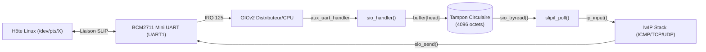

# Journal de bord - Perrytel OS

## 27. Intégration de la Pile Réseau TCP/IP (lwIP) et Pilote SLIP sous Interruptions

**Date :** 31 Octobre 2026  
**Sujet :** Intégration bare-metal de la stack réseau lwIP v2.1/v2.2 en mode autonome (`NO_SYS`), implémentation de l'interface d'E/S série (`sio.c`), routage matériel de l'interruption Mini UART (IRQ 125) sur le GICv2, encapsulation SLIP (RFC 1055), pontage réseau virtuel Host/QEMU via pseudo-terminal (`slattach`), commande `ifconfig` et validation de la connectivité ICMP Echo (Ping).

---

### 1. Introduction et Choix d'Architecture

L'introduction de capacités réseau dans **PerryTel OS** constitue une étape décisive pour transformer le système en une station Minitel connectée, capable à terme de communiquer avec des serveurs distants, d'interroger des micro-services ou de servir des pages Télétel/Videotex en ligne.

Plutôt que d'aborder immédiatement la complexité colossale des contrôleurs Gigabit Ethernet (Genet) ou des piles USB de la Raspberry Pi 4, l'approche retenue est pragmatique et modulaire :
1. **L'adoption de la pile lwIP (*Lightweight IP*)** : référence industrielle pour les systèmes embarqués et les noyaux légers, offrant une pile IPv4/IPv6, TCP, UDP et ICMP complète avec une empreinte mémoire maîtrisée.
2. **L'encapsulation SLIP (*Serial Line Internet Protocol* - RFC 1055)** : protocole de transmission de paquets IP sur liaison série asynchrone point-à-point, idéal pour interfacer le système avec le monde extérieur à travers un second port UART sans dépendance matérielle lourde.

---

### 2. Portage de lwIP en Environnement Freestanding

lwIP a été intégré directement dans l'arborescence du projet sous `drivers/lwIP/`. En l'absence de système d'exploitation sous-jacent (bare-metal) et de bibliothèque standard C hébergée, un travail d'adaptation minutieux a été réalisé via deux fichiers clés :

#### A. Configuration de l'Architecture (`drivers/lwIP/include/arch/cc.h`)
Ce fichier adapte les types de base et neutralise les dépendances vers le runtime POSIX ou la libc standard :
- **Endianness et alignement** : définition du mode Little Endian (`BYTE_ORDER LITTLE_ENDIAN`) et de l'attribut d'empaquetage des structures réseau (`PACK_STRUCT_STRUCT __attribute__((packed))`).
- **Découplage de la libc standard** :
  - `#define LWIP_NO_UNISTD_H 1` : interdit à lwIP d'inclure `<unistd.h>`, évitant les collisions de déclarations (notamment sur `rmdir` déjà présent dans l'interface Shell de PerryTel).
  - `#define LWIP_NOASSERT 1` et neutralisation des macros de diagnostic (`LWIP_PLATFORM_DIAG` et `LWIP_PLATFORM_ASSERT` définis en `do {} while (0)`), prévenant les dépendances conflictuelles vers `printf` ou `FILE`.
  - Type `ssize_t` redéfini explicitement en entier signé 64 bits (`int64_t`).

#### B. Options de la Pile (`drivers/lwIP/include/lwipopts.h`)
Le fichier d'options configure lwIP dans son profil bare-metal coopératif :
- **Mode mono-tâche sans threads (`NO_SYS 1`)** : lwIP fonctionne sans threads dédiés ni sémaphores de synchronisation. Les appels système bloquants (`LWIP_SOCKET 0`, `LWIP_NETCONN 0`) sont désactivés au profit de l'API dite *Raw/Callback*.
- **Protocoles activés** : `LWIP_TCP 1`, `LWIP_UDP 1`, `LWIP_ICMP 1`, `LWIP_ARP 1`, `LWIP_DHCP 1`.
- **Dimensionnement mémoire statique** :
  - Tas interne de lwIP : `MEM_SIZE (32 * 1024)` (32 Ko alloués aux structures réseau).
  - Pool de paquets : `PBUF_POOL_SIZE 32`, chaque tampon mesurant `PBUF_POOL_BUFSIZE 1536` octets (permettant d'accueillir un paquet Ethernet/MTU standard de 1500 octets sans fragmentation mémoire).

---

### 3. Pilote Série Dédié et Gestion sous Interruptions (`sio.c`)

Le noyau de PerryTel utilisait initialement l'**UART0 (PL011)** pour la console interactive et l'écran Minitel. Pour transporter le flux de données IP sans interférer avec les saisies utilisateur, le second contrôleur matériel, l'**UART Auxiliaire (Mini UART / UART1)** du BCM2711, a été assigné au trafic réseau.



#### A. Registres du Mini UART (BCM2711)
Les registres sont indexés à partir du décalage `0x215000` par rapport à la base MMIO (`0xFE000000` sur Raspberry Pi 4) :
- `AUX_ENABLES` (`0x215004`) : activé avec la valeur `1` pour alimenter le bloc Mini UART.
- `UART1_IO_REG` (`0x215040`) : registre de données FIFO (lecture en réception, écriture en émission).
- `UART1_IER_REG` (`0x215044`) : activé avec le bit 0 à `1` pour armer l'interruption matérielle en réception (*Enable RX Interrupt*).
- `UART1_LSR_REG` (`0x215054`) : registre d'état de la ligne :
  - Bit 0 (*Data Ready*) : indique la présence d'au moins un octet disponible en lecture dans le FIFO.
  - Bit 5 (*Transmitter Empty*) : indique que le tampon d'émission est vide et prêt à recevoir un nouvel octet.

#### B. Routage de l'Interruption GICv2 (IRQ 125)
Sur le contrôleur d'interruptions ARM GICv2 du BCM2711 :
- Les interruptions périphériques partagées (SPI) réservées aux blocs GPU/périphériques commencent à l'ID `96`.
- L'UART Auxiliaire correspond à l'interruption GPU 29. L'identifiant global transmis au GIC est donc :
  $$\text{IRQ\_ID} = 96 + 29 = 125$$
- Activation matérielle dans `gic_init()` (`drivers/gic/gic.c`) :
  - Registre `ISENABLER` : index $\lfloor 125 / 32 \rfloor = 3$, bit $125 \pmod{32} = 29$, soit `gicd->ISENABLER[3] |= (1 << 29);`.
  - Registre de cible processeur `ITARGETSR` : index $\lfloor 125 / 4 \rfloor = 31$, décalage d'octet $125 \pmod 4 = 1$ (bit 8), soit `gicd->ITARGETSR[31] |= (1 << 8);` (ciblage du Core 0).
- Branchement du gestionnaire dans la table dynamique :
  `register_interrupt(UART_AUX_INT, aux_uart_handler);` déclenchant `sio_handler()`.

#### C. Tampon Circulaire (*Ring Buffer*) dans `drivers/uart/sio.c`
Pour découpler l'arrivée asynchrone rapide des octets série et la consommation synchrone par la pile lwIP, un tampon circulaire de 4096 octets gère le flux :
1. **Producteur sous interruption (`sio_handler`)** :
   Dépile la FIFO du Mini UART tant que le bit 0 du `UART1_LSR_REG` est levé, écrit dans `buffer[head]` et incrémente `head = (head + 1) % BUFFER_LEN`.
2. **Consommateur synchrone (`sio_tryread`)** :
   Appelé par lwIP pour vider le tampon, extrait les octets entre `tail` et `head` jusqu'à concurrence de la taille demandée `len` et met à jour `tail`.
3. **Transmission sortante (`sio_send`)** :
   Effectue une attente active sur le bit 5 de `UART1_LSR_REG` (*Transmitter Empty*) avant d'écrire l'octet dans `UART1_IO_REG`.

---

### 4. Configuration SLIP et Boucle Événementielle

#### A. Initialisation Réseau (`kernel/main.c`)
Au démarrage du noyau, la pile et l'interface SLIP sont instanciées :
1. Initialisation générale du moteur lwIP : `lwip_init()`.
2. Définition des adresses IPv4 :
   - Adresse IP de PerryTel : `192.168.5.253`
   - Masque de sous-réseau : `255.255.255.0`
   - Passerelle par défaut (adresse de l'hôte) : `192.168.5.254`
3. Enregistrement de l'interface réseau :
   `netif_add(&net, &ip, &mask, &gateway, &state, slipif_init, ip_input);`
4. Activation et désignation par défaut :
   `netif_set_default(&net);` puis `netif_set_up(&net);`.

#### B. Boucle Interactive et Polling Réseau (`kernel/shell.c`)
En mode `NO_SYS`, lwIP s'appuie sur une boucle de scrutation coopérative intégrée à `run_shell()` :
- `sys_check_timeouts()` : met à jour les timers internes (retransmission TCP, expiration ARP, timers ICMP).
- `slipif_poll(netif_default)` : lit les octets en attente dans le tampon circulaire via `sio_tryread()`, délimite les trames par le marqueur `0xC0` (SLIP `END`), applique le dé-échappement et injecte le paquet reconstitué dans `ip_input()`.

#### C. La Commande Shell `ifconfig`
Une commande d'inspection interactive a été ajoutée au Shell pour valider la configuration :
```text
Perry (/) -> ifconfig
--------------
sl0 UP
inet 192.168.5.253
mask 255.255.255.0
gateway 192.168.5.254
```

---

### 5. Pont Réseau Virtuel avec l'Hôte Linux

#### A. Configuration QEMU (`build.sh`)
L'émulateur est lancé avec deux ports série émulés :
- `-serial stdio` : UART0 relié à la console du terminal hôte.
- `-serial pty` : UART1 redirigé vers un pseudo-terminal UNIX dynamique (ex: `/dev/pts/3`).

#### B. Attachement SLIP sur la Machine Hôte
Sur la machine hôte Linux, la liaison série est rattachée à l'interface réseau du noyau :
1. Attachement de la ligne série en mode SLIP standard :
   `sudo slattach -p slip -s 115200 /dev/pts/X &`
   *(Remarque critique : ne pas utiliser l'option `-p cslip` car lwIP ne gère pas la compression d'en-tête Van Jacobson).*
2. Configuration de l'interface point-à-point hôte :
   `sudo ip addr add 192.168.5.254 peer 192.168.5.253/32 dev sl0`
   `sudo ip link set sl0 up`
3. **Partitionnement des sous-réseaux** : l'attribution d'un sous-réseau dédié (`192.168.5.0/24`) évite toute interférence avec le routage de l'interface physique Wi-Fi/Ethernet de l'hôte (`192.168.1.0/24`).

---

### 6. Validation Expérimentale : Ping ICMP Réussi

Le test d'interconnexion a été validé par l'envoi de requêtes ICMP Echo Request depuis le système d'exploitation hôte vers le noyau PerryTel s'exécutant dans QEMU :

```text
$ ping -c 2 192.168.5.253
PING 192.168.5.253 (192.168.5.253) 56(84) bytes of data.
64 bytes from 192.168.5.253: icmp_seq=1 ttl=255 time=1.20 ms
64 bytes from 192.168.5.253: icmp_seq=2 ttl=255 time=1.19 ms

--- 192.168.5.253 ping statistics ---
2 packets transmitted, 2 received, 0% packet loss, time 1002ms
rtt min/avg/max/mdev = 1.191/1.198/1.206/0.007 ms
```

**Bilan du test :**
- **0% de perte de paquets** sur la liaison SLIP émulée.
- Temps d'aller-retour moyen (*RTT*) de **1.19 ms**.
- Traitement complet de la pile sans débordement de tampon mémoire ni panique noyau.

---

### 7. Synthèse des Composants et Rôles

| Fichier / Module | Emplacement | Rôle et Responsabilité |
| :--- | :--- | :--- |
| `arch/cc.h` | `drivers/lwIP/include/arch/` | Abstraction architecture ARM64 freestanding, types, neutralisation libc. |
| `lwipopts.h` | `drivers/lwIP/include/` | Configuration statique de lwIP (mono-tâche `NO_SYS`, protocoles IPv4, tampons). |
| `sio.c` | `drivers/uart/` | Implémentation du pilote série lwIP, Ring Buffer 4 Ko, gestionnaire `sio_handler`. |
| `sio-uart.h` | `include/kernel/` | Déclarations de liaison entre le gestionnaire d'exceptions et le pilote `sio`. |
| `gic.c` | `drivers/gic/` | Configuration du Distributeur GICv2 pour armer l'IRQ 125 du Mini UART sur le Core 0. |
| `exception.c` | `kernel/` | Interception de l'IAR 125 et routage vers `aux_uart_handler()`. |
| `main.c` | `kernel/` | Enregistrement de l'interface SLIP, attribution de l'IP `192.168.5.253` et activation réseau. |
| `shell.c` | `kernel/` | Commande `ifconfig`, appels coopératifs `sys_check_timeouts` et `slipif_poll`. |
| `build.sh` | Racine | Ajout de `-serial pty` et flags d'inclusion pour la compilation croisée bare-metal. |

---
*Document consigné pour la vault Obsidian - PerryTel OS Project.*
